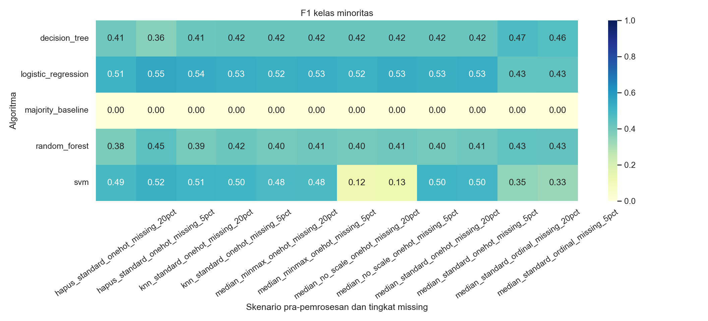
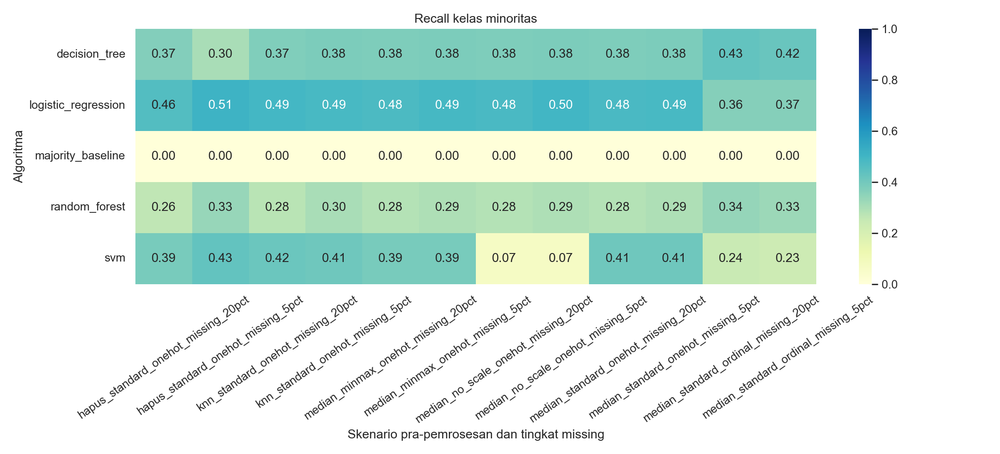
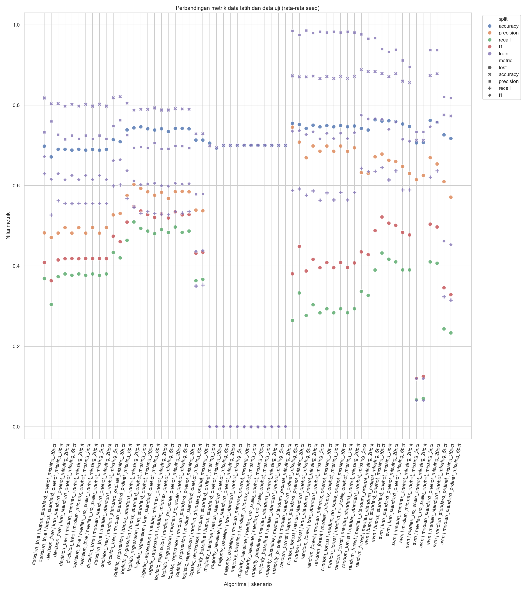
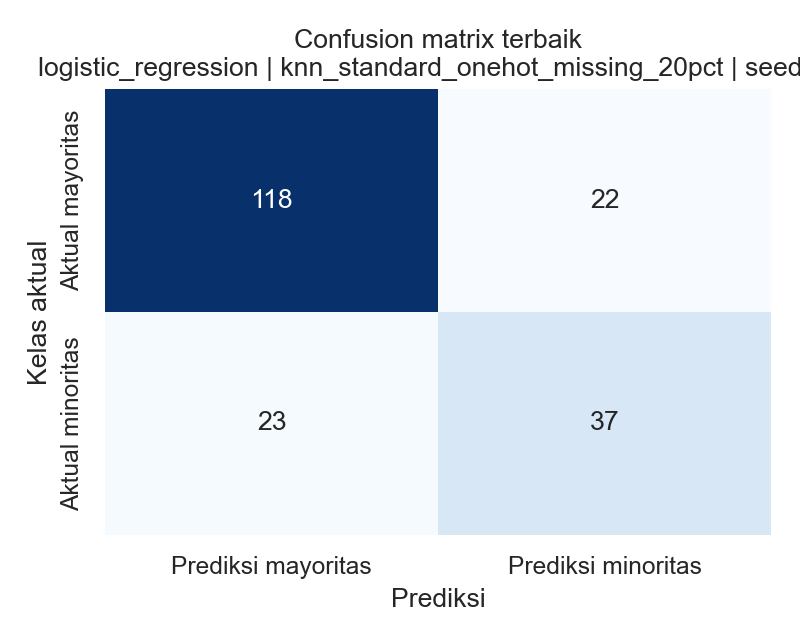
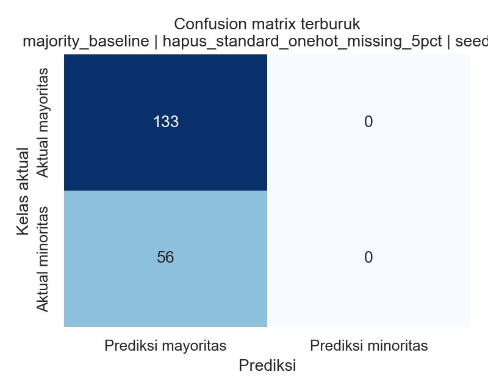

# Pengaruh Teknik Pra-pemrosesan terhadap Performa Klasifikasi

Studi kasus ini membandingkan pengaruh penanganan missing value, skala fitur numerik, dan encoding fitur kategorikal pada klasifikasi risiko kredit. Implementasi memakai pipeline scikit-learn agar imputasi, penskalaan, dan encoding hanya dipelajari pada bagian latih di setiap split/cross-validation.

## Latar belakang

Materi kuliah praktisi **“Introduction to Machine Learning”** oleh Ibu Taniza Tajudin menekankan kualitas data dan pra-pemrosesan, pembagian data latih/uji, evaluasi dengan accuracy, precision, recall, F1, dan confusion matrix, kewaspadaan pada akurasi sempurna, serta percobaan berulang dengan beberapa algoritma. Materi menyebut klasifikasi persetujuan pinjaman dan churn pelanggan sebagai contoh.

Proyek ini menerapkan gagasan tersebut pada risiko kredit. Dataset, pilihan algoritma, skenario, dan hiperparameter adalah **usulan implementasi**; hasil tidak dianggap berlaku untuk domain lain.

## Dataset dan status missing value

Program mencoba mengambil **German Credit, OpenML `credit-g` (dataset 31)** melalui `sklearn.datasets.fetch_openml`. Jika OpenML tidak terjangkau, sumber `auto` beralih dengan warning ke data **sintetis** `sklearn.datasets.make_classification`. Mode `synthetic` dan `openml` juga dapat dipilih secara eksplisit.

Hasil final pada repositori ini menggunakan data OpenML: **1.000 baris, 20 fitur** (7 numerik dan 13 kategorikal), tanpa missing value pada data asli. Kelasnya 300 `bad` (30%, minoritas/label positif) dan 700 `good` (70%). Jika OpenML tidak terjangkau, mode `auto` memakai data sintetis `sklearn.datasets.make_classification`; hasil fallback itu bukan data peminjam nyata. Sumber yang benar-benar digunakan dan versi pustaka dicatat di `reports/metadata.json`. Pada eksekusi ini: Python 3.11.9, scikit-learn 1.7.2, pandas 2.3.2, dan NumPy 2.1.3.

Missing value disisipkan **secara buatan** pada fitur saja: masing-masing 5% dan 20% baris dipilih dengan seed tetap, lalu tepat satu dari 20 fitur pada setiap baris terpilih dibuat kosong. Jadi persentase tersebut adalah persentase baris yang terdampak, bukan persentase semua sel. Target tidak diubah. Sebanyak 12 salinan baris ditambahkan untuk menguji pembersihan; salinan dengan fitur **dan label** yang sama dihapus sebelum eksperimen. Jumlah missing dan duplikat tercatat dalam CSV dan metadata.

## Alur eksperimen

```text
OpenML German Credit (jika tersedia) / make_classification (fallback)
                              |
             tambahkan duplikat buatan untuk uji pembersihan
                              |
              hapus record fitur + target duplikat
                              |
     sisipkan missing buatan pada 5% dan 20% baris (fitur saja)
                              |
         split 80/20 stratified untuk setiap seed
                              |
 Pipeline imputer + scaler + encoder (fit hanya pada data latih)
                              |
      5-fold Stratified CV hanya pada bagian data latih
                              |
 dummy mayoritas + logistic regression + tree + SVM + random forest
                              |
 accuracy, precision, recall, F1, confusion matrix, ROC-AUC tambahan
                              |
          CSV hasil/ringkasan + heatmap dan grafik
```

Enam skenario pra-pemrosesan di `config.yaml` dikombinasikan dengan dua tingkat missing (12 skenario): hapus baris, imputasi median, KNN imputer, tanpa skala, MinMax, dan ordinal encoding dibandingkan OneHot. Model, hiperparameter, lima seed, fraksi split, serta lipatan CV juga dicatat di konfigurasi. OrdinalEncoder memberi urutan angka pada kategori tanpa urutan alami; untuk itu interpretasi model dapat terpengaruh oleh urutan yang dibuat encoder.

## Instalasi dan menjalankan

Gunakan Python 3.10 atau lebih baru. Dari folder proyek:

```powershell
python -m venv .venv
.\.venv\Scripts\Activate.ps1
python -m pip install -r requirements.txt
python -m unittest discover -s tests -v
python -m src.main
```

Mode offline yang memastikan penggunaan data sintetis:

```powershell
python -m src.main --source synthetic
```

Untuk meminta German Credit tanpa fallback:

```powershell
python -m src.main --source openml
```

Jika internet/OpenML tidak tersedia, perintah tanpa `--source` menggunakan fallback sintetis dan menampilkan warning. `--seeds 1` menjalankan smoke test cepat; **hasil laporan akhir** dibuat dengan semua lima seed. Pada lingkungan ini, run final lima seed berhasil selesai dalam waktu kurang dari tiga menit; sediakan beberapa menit pada perangkat lain karena waktu bergantung pada CPU dan ketersediaan OpenML.

## Hasil eksperimen aktual

Eksperimen final menjalankan 12 skenario × 5 algoritma (termasuk baseline) × 5 seed = **300 evaluasi holdout**. Tabel berikut mengambil skenario acuan `median_standard_onehot_missing_5pct`; nilai ditulis sebagai rata-rata ± simpangan baku dari lima seed. Recall, precision, dan F1 menganggap kelas minoritas `bad` sebagai positif. CV adalah F1 macro lima lipatan pada bagian latih, lalu dirata-ratakan atas seed. ROC-AUC adalah **usulan metrik tambahan**, bukan metrik yang disebut dalam konteks materi.

### Ringkasan per algoritma

| Algoritma | Accuracy uji | Precision minoritas | Recall minoritas | F1 minoritas | F1 macro CV |
|---|---:|---:|---:|---:|---:|
| Baseline mayoritas | 0,7000 ± 0,0000 | 0,0000 ± 0,0000 | 0,0000 ± 0,0000 | 0,0000 ± 0,0000 | 0,4118 ± 0,0000 |
| Logistic Regression | 0,7410 ± 0,0243 | 0,5844 ± 0,0492 | 0,4867 ± 0,0820 | 0,5278 ± 0,0539 | 0,6835 ± 0,0132 |
| Decision Tree | 0,6900 ± 0,0334 | 0,4954 ± 0,0858 | 0,3800 ± 0,1063 | 0,4180 ± 0,0658 | 0,6131 ± 0,0372 |
| SVM | 0,7570 ± 0,0189 | 0,6536 ± 0,0560 | 0,4067 ± 0,0871 | 0,4968 ± 0,0738 | 0,6590 ± 0,0145 |
| Random Forest | 0,7480 ± 0,0217 | 0,6937 ± 0,0911 | 0,2933 ± 0,0760 | 0,4074 ± 0,0763 | 0,6069 ± 0,0171 |

Ringkasan lintas seluruh skenario menunjukkan rata-rata F1 minoritas tertinggi pada Logistic Regression (0,5121); angka ini merupakan rerata 60 kombinasi skenario-seed, bukan hasil dari satu konfigurasi terpilih. Konfigurasi individual terbaik memperoleh F1 0,6218 (KNN + StandardScaler + OneHot, missing buatan 20%, Logistic Regression, seed 11); ini satu hasil holdout dan bukan estimasi kinerja umum.

### Dampak skenario pra-pemrosesan

Heatmap menampilkan rata-rata F1 dan recall minoritas menurut algoritma dan skenario, sehingga efek praproses dapat dibandingkan tanpa memilih akurasi saja.











Perubahan berikut adalah selisih rata-rata F1 dan recall minoritas terhadap skenario acuan yang hanya berbeda pada faktor terkait. Perhitungan dipasangkan pada algoritma, seed, dan tingkat missing, kemudian dirata-ratakan (50 pasangan untuk setiap perbandingan):

| Perubahan | Δ F1 | Δ recall | Catatan dari hasil |
|---|---:|---:|---|
| KNN vs median | +0,0013 | +0,0020 | Perbedaan rata-rata kecil |
| Hapus baris vs median | -0,0028 | -0,0056 | Hampir sama; baris yang terhapus mengurangi data latih/uji |
| Tanpa skala vs StandardScaler | -0,0756 | -0,0670 | Penurunan terbesar pada rata-rata gabungan |
| MinMaxScaler vs StandardScaler | -0,0044 | -0,0037 | Perbedaan rata-rata kecil |
| Ordinal vs OneHot | -0,0358 | -0,0397 | Rata-rata lebih rendah; ordinal memberi urutan artifisial pada kategori |

## Analisis dan pemeriksaan overfitting

- Bandingkan accuracy dengan precision, recall, F1, dan confusion matrix; baseline mayoritas dapat memiliki accuracy yang tampak tinggi meski recall kelas minoritas rendah.
- `overfit_flag` menandai selisih F1 latih-uji di atas ambang konfigurasi atau accuracy latih yang mendekati sempurna. Ini indikator sederhana untuk ditinjau, bukan bukti tunggal overfitting.
- Sebanyak 179 dari 300 evaluasi ditandai karena gap F1 latih-uji lebih dari 0,10; tidak ada accuracy latih/uji yang mencapai ambang 0,98. Baseline mayoritas meraih accuracy sekitar 0,70 tetapi recall dan F1 kelas `bad` sama-sama 0, sehingga accuracy saja menyembunyikan kegagalan mendeteksi kelas minoritas.
- Pembandingan StandardScaler, MinMaxScaler, dan tanpa skala memperlihatkan apakah algoritma sensitif pada besaran fitur. Logistic regression dan SVM umumnya dapat dipengaruhi skala; pohon keputusan dan random forest biasanya tidak memerlukan penskalaan untuk aturan split. Kesimpulan khusus untuk dataset ini harus mengikuti tabel hasil aktual, bukan asumsi umum.
- KNN imputer memanfaatkan jarak fitur sehingga efek skala sebelum imputasi perlu dipertimbangkan. Pada pipeline ini, strategi skala dilakukan setelah imputasi; KNN menggunakan skala asli fitur numerik.
- Skenario hapus baris menghapus observasi yang memiliki missing pada fitur mana pun. Pada missing buatan 5%, rata-rata tersisa 762 baris latih dan 188 uji; pada 20%, tersisa 642 latih dan 158 uji. Jumlah pastinya sedikit berbeda antar-seed.
- Bila eksperimen hanya menunjukkan perbedaan kecil, hasil dilaporkan demikian; tidak ada angka yang dipaksakan untuk menguatkan dugaan.

## Keterbatasan dan pelajaran utama

Eksperimen memakai satu dataset saja; hasil tidak otomatis berlaku pada churn, persetujuan pinjaman lain, atau domain berbeda. Jika OpenML gagal, fallback sintetis bukan data nyata. Missing value sengaja dibuat acak sederhana dan mungkin tidak menyerupai proses hilangnya data di lapangan. Penghapusan duplikat tidak menggantikan pemahaman kualitas data. Hiperparameter model adalah nilai awal yang tercatat di konfigurasi dan tidak dioptimalkan. Pemilihan satu label minoritas sebagai kelas positif dibuat untuk membandingkan recall, sedangkan evaluasi multi-kelas memerlukan definisi berbeda.

Pelajaran utama: evaluasi harus menguji keseluruhan alur, mencegah prapemrosesan melihat data uji, membandingkan beberapa metrik dan algoritma, serta mengulang eksperimen dengan seed berbeda. Pada hasil ini, pilihan penskalaan dan encoding memengaruhi skor rata-rata lebih besar daripada pilihan median versus KNN, tetapi dampak berubah menurut algoritma dan konfigurasi. Akurasi tinggi saja tidak cukup untuk menilai klasifikasi pada kelas yang tidak seimbang.

## Berkas hasil

- `reports/hasil_eksperimen.csv`: metrik setiap kombinasi skenario, algoritma, seed, confusion matrix, train/test gap, dan skor CV.
- `reports/ringkasan.csv`: mean dan simpangan baku lintas seed per skenario/model.
- `reports/metadata.json`: sumber dataset, jumlah record/fitur, proporsi kelas, duplicate, missing cells, seed, dan versi lingkungan.
- `reports/figures/`: heatmap F1/recall, confusion matrix terbaik/terburuk, serta grafik train versus test.

## Struktur proyek

```text
README.md
requirements.txt
.gitignore
config.yaml
data/README.md
src/{data_loader.py,preprocessing.py,train_evaluate.py,plot_results.py,main.py}
reports/{hasil_eksperimen.csv,ringkasan.csv,metadata.json,figures/}
tests/test_ml_pipeline.py
```

## Mengunggah ke GitHub

Buat repositori bernama `pengaruh-praproses-klasifikasi`, lalu dari folder proyek:

```powershell
git init
git add README.md requirements.txt .gitignore config.yaml data src tests reports
git commit -m "Tambahkan eksperimen pengaruh prapemrosesan klasifikasi"
git branch -M main
git remote add origin https://github.com/USERNAME/pengaruh-praproses-klasifikasi.git
git push -u origin main
```

Ganti `USERNAME` dengan akun GitHub Anda. Jika remote `origin` sudah tersedia, gunakan `git remote set-url origin ...`.
